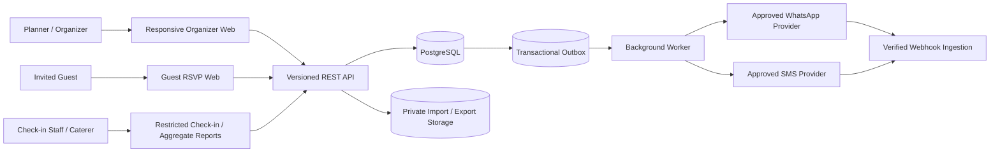
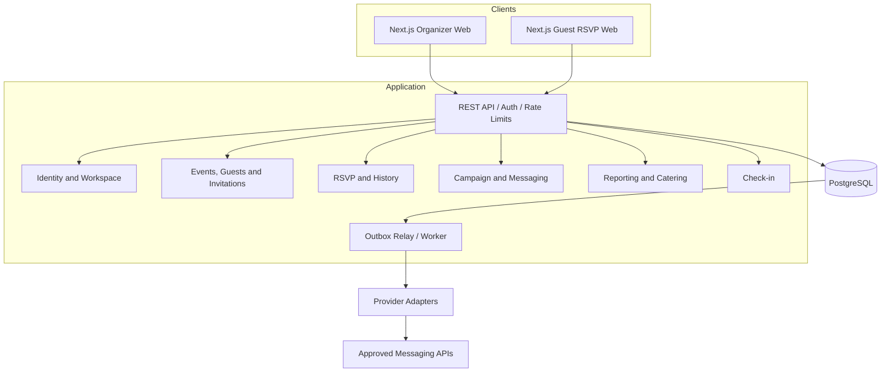
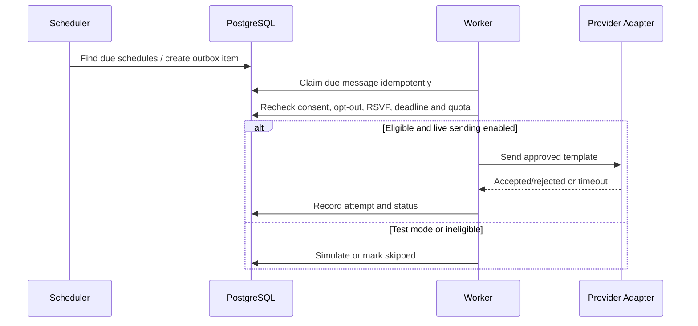
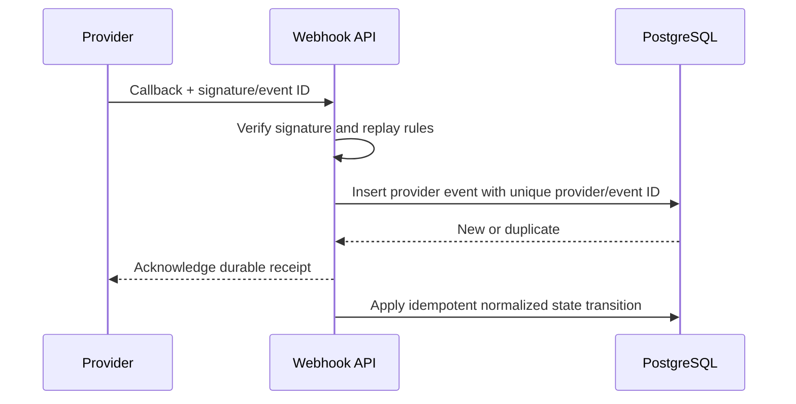
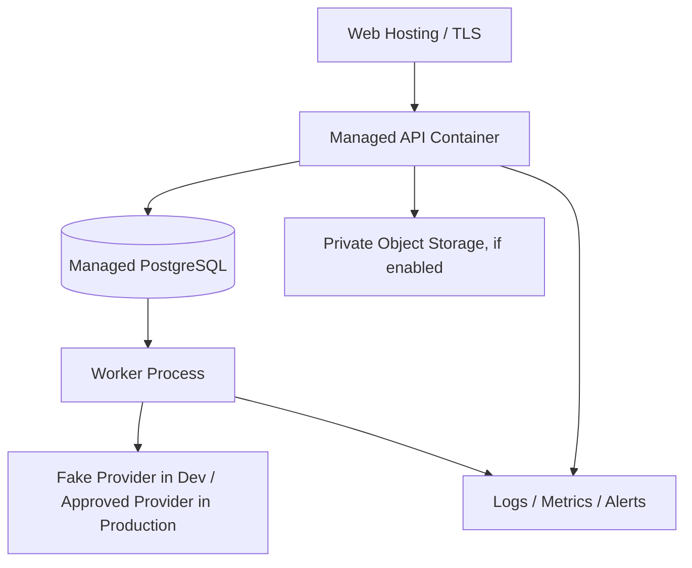

# Architecture Diagrams

## System context


## Container/component architecture


## RSVP sequence
```mermaid
sequenceDiagram
  participant G as Guest Browser
  participant A as API
  participant D as PostgreSQL
  G->>A: Open invitation link
  A->>D: Resolve hashed token and invitation scope
  D-->>A: Minimal event/function details
  A-->>G: RSVP form without guest directory
  G->>A: Submit response + version
  A->>D: Validate deadline/cap; write response, history and outbox transactionally
  D-->>A: Commit
  A-->>G: Confirmation
```

## Reminder dispatch sequence


## Webhook sequence


## Deployment baseline


## Important asynchronous boundaries
Outbox processing, provider delivery callbacks and import/export jobs are asynchronous. HTTP acceptance must not be presented as final delivery. Every asynchronous item needs a stable ID, retry policy, deduplication key, terminal failure state and documented replay behavior. Payment is outside MVP.
