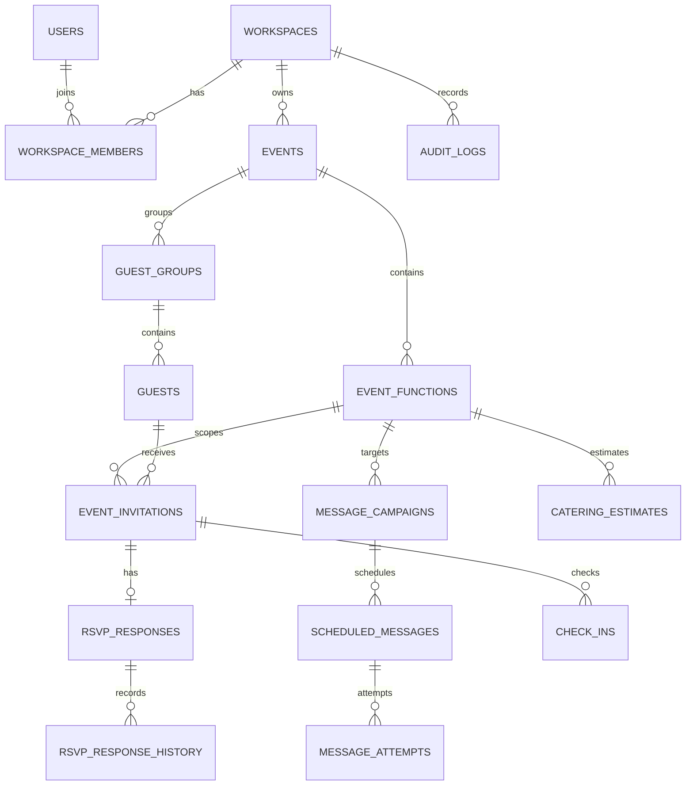

# Initial ERD

## Modeling rules
- `guest_groups` are households/party groupings, not attendance counts.
- `guests` represent contactable people or a group contact when identity details are unavailable; avoid duplicate person rows when a shared phone is used.
- `event_invitations` is the per-function invitation and is the source of the invited party-size cap.
- `rsvp_responses` is per invitation/function, never per wedding globally.
- Store `adult_count` and `child_count` explicitly. The attendee total is their sum for Yes; Maybe remains separate.
- Actual attendance is represented by check-in records, not by overwriting RSVP.
- Provider events, message attempts and response history are append-oriented audit data.
- All tenant-owned rows include `workspace_id` where practical. Foreign keys and service checks enforce matching workspace/event relationships.
